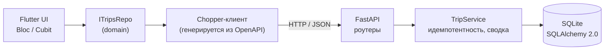

# Дневник смен водителя

Мини-проект: сервер на **FastAPI** и мобильный/десктопный клиент на **Flutter**. Водитель видит поездки за выбранный день и сводку (число поездок, выручка, комиссия, «на руки», разбивка наличные/карта), листает дни и добавляет поездки. Повторная отправка той же поездки дубль не создаёт.

- [Что сделано](#что-сделано)
- [Быстрый запуск](#быстрый-запуск)
- [API](#api)
- [Принятые решения и допущения](#принятые-решения-и-допущения)
- [Архитектура](#архитектура)
- [Тесты и покрытие](#тесты-и-покрытие)
- [Работа с кодогенерацией](#работа-с-кодогенерацией)
- [Ограничения](#ограничения)

## Что сделано

| Требование задания | Как реализовано |
|---|---|
| Сервер отдаёт поездки за день и сводку | `GET /api/v1/trips?date=` и `GET /api/v1/summary?date=`; сводка: число поездок, выручка, комиссия, «на руки», разбивка наличные/карта |
| Клиент показывает сводку и список, переключает дни | Экран дня: стрелки «вчера/завтра», календарь, карточка сводки, список поездок, pull-to-refresh |
| Добавление поездки с проверкой данных | `POST /api/v1/trips`: сумма > 0, окончание позже начала (плюс комиссия от 0 до суммы, часовой пояс обязателен). Те же правила проверяет форма в клиенте |
| Повторная отправка не создаёт дубль | `id` задаёт клиент и он же — ключ идемпотентности. Повтор → `200` с сохранённой поездкой, тот же `id` с другими данными → `409`. Уникальность гарантирует PRIMARY KEY, а не предварительная проверка, поэтому параллельные запросы тоже безопасны |
| Тесты на расчёт сводки и защиту от дублей | `backend/tests/test_summary.py`, `test_trip_idempotency.py` (в том числе 16 параллельных запросов → ровно одна запись); на клиенте — тесты `AddTripBloc` (повтор с тем же `id`) и всех экранов |
| Файл с поездками в JSON | `backend/data/trips.json` в формате примера из задания; при первом запуске загружается в пустую БД (73 поездки за 1–12 октября 2026) |
| README, как запустить | Этот файл |

Сверх задания (по моим пожеланиям к стеку): Swagger/OpenAPI, генерация API-клиента из схемы, светлая/тёмная тема, ru/en, анимации, строгий ввод чисел и времени, ночные поездки (через полночь).

## Быстрый запуск

Нужно: **Python 3.11+** (проверено на 3.14) и **Flutter 3.47** (Dart 3.13).

### 1. Backend

PowerShell (Windows):

```powershell
cd backend
python -m venv .venv
.venv\Scripts\Activate.ps1
pip install -e ".[dev]"
uvicorn app.main:app --reload
```

bash (Linux / macOS / Git Bash):

```bash
cd backend
python -m venv .venv
source .venv/bin/activate          # Git Bash на Windows: source .venv/Scripts/activate
pip install -e ".[dev]"
uvicorn app.main:app --reload
```

- Swagger UI: <http://localhost:8000/docs> (там же можно пробовать запросы), схема: `/openapi.json`.
- БД — файл `backend/driver_diary.db` (создаётся сам, в git не попадает). Чтобы начать с чистого seed, удалите его.
- Настройки необязательны: `Copy-Item .env.example .env` (`DATABASE_URL`, `SEED_ON_START`).

### 2. Клиент

```bash
cd client
flutter pub get
flutter run -d windows          # или: -d <id эмулятора>, см. flutter devices
```

Сгенерированный код и `env.g.dart` лежат в репозитории, поэтому больше ничего запускать не нужно.

**Данные:** приложение открывается на сегодняшнем дне, а поездки в seed — за 1–12 октября 2026. Выберите день в календаре (нажмите на дату вверху): `1 октября 2026` — это пример из задания (2 поездки: выручка 3 900, комиссия 585, «на руки» 3 315).

**Адрес backend** задаётся в `client/.env` (шаблон — `.env.example`, по умолчанию `http://127.0.0.1:8000`):

| Где запущено приложение | Что делать |
|---|---|
| Windows | ничего, `127.0.0.1` |
| Android-эмулятор | ничего: на Android `127.0.0.1`/`localhost` автоматически заменяется на `10.0.2.2` (так эмулятор видит ваш компьютер) |
| Реальное устройство | указать IP компьютера в сети, например `http://192.168.1.10:8000`, и запускать backend с `uvicorn app.main:app --host 0.0.0.0` |

После правки `.env` нужно перегенерировать `env.g.dart` и перезапустить приложение целиком (hot reload не подойдёт):

```bash
dart run build_runner build --delete-conflicting-outputs
```

Если на экране «Нет связи с сервером» — он показывает, к какому адресу шло обращение, а точная причина сбоя пишется в консоль отладки (`TripsRepo: запрос не удался: …`).

**Платформы.** Я проверял вручную Windows и Android-эмулятор. Для iOS настроен доступ к локальной сети (`Info.plist`), но на устройстве я его не запускал. Каталоги `linux`, `macos`, `web` созданы `flutter create` и не настраивались: для web, например, не хватает CORS на сервере. На Android HTTP к локальному backend разрешён только в debug/profile-сборках, release остаётся HTTPS-only.

## API

Базовый путь `/api/v1`. Все поля в запросах и ответах обязательные и не nullable (так клиент генерируется без `dynamic`).

| Метод | Путь | Описание |
|---|---|---|
| `GET` | `/trips?date=YYYY-MM-DD` | Поездки за день, по возрастанию начала |
| `GET` | `/summary?date=YYYY-MM-DD` | Сводка за день |
| `POST` | `/trips` | Добавить поездку (идемпотентно) |
| `GET` | `/health` | Проверка, что сервер жив (вне схемы OpenAPI) |

Поездка (формат из задания; `payment` — `cash` или `card`):

```json
{"id": "t1", "start": "2026-10-01T08:10:00+05:00", "end": "2026-10-01T08:32:00+05:00",
 "amount": 2400, "payment": "card", "commission": 360}
```

Сводка `GET /summary?date=2026-10-01`:

```json
{
  "date": "2026-10-01", "trips_count": 2, "revenue": 3900, "commission": 585, "net": 3315,
  "by_payment": {
    "cash": {"trips_count": 1, "revenue": 1500, "commission": 225, "net": 1275},
    "card": {"trips_count": 1, "revenue": 2400, "commission": 360, "net": 2040}
  }
}
```

Оба ключа `cash` и `card` есть всегда, даже если поездок не было (нули).

Ответы `POST /trips`:

| Код | Когда |
|---|---|
| `201` | поездка создана |
| `200` | та же поездка уже есть (тот же `id` и то же содержимое) — возвращается сохранённая, дубля нет |
| `409` | поездка с таким `id` уже есть, но с другими данными |
| `422` | данные не прошли проверку |

Правила проверки: `id` — 1–64 символа (`A-Za-z0-9_.:-`); `amount` — целое > 0; `commission` — целое от 0 до `amount`; `start` и `end` — ISO 8601 **со смещением часового пояса** (без него — `422`), `end` строго позже `start`; лишние поля запрещены.

Пример (`curl`; в PowerShell используйте `curl.exe` или Swagger UI):

```bash
curl -s "http://localhost:8000/api/v1/summary?date=2026-10-01"

curl -s -X POST http://localhost:8000/api/v1/trips -H "Content-Type: application/json" \
  -d '{"id":"demo-1","start":"2026-10-12T09:00:00+05:00","end":"2026-10-12T09:30:00+05:00","amount":3000,"payment":"cash","commission":450}'
# повторите команду: 201 → 200, в списке остаётся одна поездка
```

## Принятые решения и допущения

- **«На руки» = выручка − комиссия.** Задание формулу не уточняет, это моё допущение.
- **День поездки — по дате её начала в её собственном часовом поясе** (смещение из ISO-строки), а не по UTC. Поездка, начатая в 23:40 и законченная в 00:25, относится ко дню начала. В БД хранятся UTC-момент, исходное смещение и `local_date` (по ней отбираются поездки дня); в ответе возвращается исходное смещение (`+05:00`).
- **Идемпотентность.** Ключ — `id` поездки, его создаёт клиент (UUID). Сервер сравнивает повтор по содержимому: тот же момент времени в другом поясе считается той же поездкой. На клиенте `AddTripBloc` при сбое отправки повторяет запрос **с тем же `id`** (если данные не менялись), а если данные изменили — выдаёт новый; двойное нажатие «Сохранить» отбрасывается (`droppable`).
- **Деньги — целые числа** (тенге без копеек, как в примере). Поля сумм принимают только цифры и **отклоняют недопустимую правку целиком**, а не вырезают лишнее: иначе вставка «2400,50» превратилась бы в 240050. Время вводится по маске `ЧЧ:ММ` или выбирается на циферблате.
- **Комиссия — обычное поле поездки**, а не вычисляемое: по сути её определяет сервис, и она может отличаться. В форме она по умолчанию подставляется как **15% от суммы** — это моё допущение по двум строкам примера (360 из 2400 и 225 из 1500), а не требование; значение можно поменять, константа — `Constants.defaultCommissionPercent`.
- **Поездки через полночь.** Если время окончания в форме раньше времени начала, окончание — на следующий день (23:00 → 00:30), под полем показывается подсказка «На следующий день». Одинаковое время — ошибка.
- **Время на экране** показывается «настенным» по смещению самой поездки, а не часовым поясом устройства. Новые поездки уходят со смещением устройства.
- **В OpenAPI момент времени описан строкой, а не `format: date-time`.** Генератор Dart превратил бы его в `DateTime`, а тот не хранит смещение (`+05:00` терялось бы, и день поездки на клиенте и сервере мог разойтись). Поэтому на клиенте есть модель `OffsetDateTime` (момент + смещение).
- **Сводка считается чистой функцией** в Python по поездкам дня (десятки записей — SQL-агрегация не нужна), поэтому её просто тестировать.
- **Сознательно нет:** авторизации (в задании не требуется), миграций БД (схема создаётся при старте), редактирования и удаления поездок, пагинации.

## Архитектура



### Backend (`backend/`)

```
app/
  main.py            create_app(): lifespan (создание схемы, seed), метаданные Swagger
  core/config.py     настройки из .env (pydantic-settings)
  api/v1/            роутеры (trips, summary), зависимости
  schemas/           Pydantic-модели запросов и ответов, правила проверки
  services/          TripService: идемпотентное добавление, выборка, сводка
  repositories/      TripRepository: единственное место, знающее про SQL
  domain/summary.py  calculate_summary() — чистая функция расчёта сводки
  db/                модели и сессии SQLAlchemy
  seed.py            загрузка data/trips.json в пустую БД
scripts/export_openapi.py   выгрузка схемы для генерации клиента
tests/                      pytest
```

Слои разделены: роутер знает про HTTP, сервис — про правила, репозиторий — про БД, расчёт сводки не знает ни о чём. Идемпотентность решается на уровне БД (PRIMARY KEY + обработка `IntegrityError` с повторным чтением и сравнением), а не проверкой «есть ли уже такая запись».

### Клиент (`client/lib/`)

Чистая архитектура: слои `data` → `domain` ← `presentation`, плюс `app` (сборка приложения) и `shared` (общее).

```
app/            my_app.dart, DI (get_it), go_router, тема (светлая/тёмная), язык
domain/         модели (freezed), интерфейс репозитория, валидатор поездки, ошибки
data/           репозиторий поверх сгенерированного API-клиента, мапперы DTO → domain
presentation/
  bloc/         DiaryBloc (день), AddTripBloc (отправка формы)
  features/     diary, add_trip, settings — страницы и их widgets/
  common/       общие для экранов расширения (тексты ошибок, оплата)
shared/
  ui/           свои компоненты (карточки, кнопки, поля, сегменты) и animations/
  storage/      shared_preferences (тема, язык), .env через envied
  utils/        форматтеры денег/дат/времени, строгий ввод, разбор адреса
l10n/           ARB-файлы ru и en (intl_utils)
swagger_generated_code/   API-клиент (генерируется, лежит в репозитории)
```

- **Состояние.** Экран дня — `DiaryBloc` с `restartable()`: ответ на устаревший запрос (если пользователь успел уйти на другой день) не попадает в состояние. Отправка формы — `AddTripBloc` с `droppable()`. События и состояния — freezed-union'ы. Тема и язык — `Cubit` (`ThemeCubit`, `LocaleCubit`), выбор хранится в shared_preferences.
- **Ошибки без исключений.** Репозиторий возвращает `Result<T, TripsError>` (sealed-класс), UI разбирает его в `switch`.
- **Модели.** Domain-модели — freezed. `OffsetDateTime` хранит момент и смещение пояса.
- **API-клиент** генерируется из OpenAPI-схемы backend (`swagger_dart_code_generator` + chopper), без ручного описания запросов.
- **Локализация.** `intl` + ARB, русский и английский, «как в системе» по умолчанию; названия языков не переводятся.
- **Анимации.** Fade-переходы между страницами, каскадное появление блоков, «досчитывание» суммы, нажатие кнопки; уважается системная настройка «убрать анимации». Токены — `app/theme/app_motion.dart`.
- **Оформление.** Собственные компоненты в `shared/ui` с цветами и радиусами в стиле iOS (палитра на `ThemeExtension`), светлая и тёмная тема.

## Тесты и покрытие

| | Тестов | Покрытие | Запуск |
|---|---|---|---|
| Backend | 71 | 99% (282 строки, 1 не покрыта) | `cd backend && pytest --cov=app` |
| Клиент | 378 | 99,5% по строкам, без сгенерированного кода | `cd client && flutter test --coverage && dart run tool/coverage.dart` |

Линтеры: `ruff check . && ruff format --check .` (backend), `flutter analyze` (клиент).

**Backend** (pytest, `TestClient`, SQLite в памяти):
- расчёт сводки: пример из задания, пустой день (оба способа оплаты с нулями), один способ оплаты, граничные значения, согласованность итогов на 200 случайных поездках;
- защита от дублей: повтор → `200` и одна запись, тот же `id` с другими данными → `409` и исходные данные не меняются, тот же момент в другом поясе — та же поездка, имитация гонки между проверкой и вставкой, 16 параллельных запросов с одним `id` → ровно одна запись;
- проверка данных (сумма, порядок времени, пояс, комиссия, `id`, лишние поля), выбор поездок по дню (поездка через полночь, разные смещения), seed, стабильность OpenAPI-схемы.

**Клиент** (`flutter_test`, `bloc_test`, `mocktail`):
- domain: валидатор, `OffsetDateTime`; data: репозиторий (статусы, обрыв связи, таймаут, неразборчивый ответ) в том числе со сгенерированным клиентом и настоящим JSON;
- Bloc: в том числе отмена устаревших запросов и повтор отправки с тем же `id`;
- виджеты: все экраны и общие компоненты (в тёмной теме и на английском тоже), форма с ночными поездками, строгим вводом и ошибками, анимации;
- оболочка приложения целиком: DI, роутинг, смена темы и языка с сохранением.

Скрипт `tool/coverage.dart` исключает сгенерированный код и **отдельно перечисляет файлы, которые тесты не загружают**: `flutter test` не включает такие файлы в `lcov.info`, и без этого процент выглядел бы лучше, чем есть. Сейчас это только объявления без логики (enum, интерфейсы, константы), `main.dart` и `env.dart`.

## Работа с кодогенерацией

Сгенерированные файлы лежат в репозитории. Менять их нужно только после правок:

```bash
# backend: API изменился → выгрузить схему и обновить клиент
cd backend && python scripts/export_openapi.py
cd ../client && dart run tool/generate_api.dart     # удаляет lib/swagger_generated_code и запускает build_runner

# freezed-модели и env.g.dart (после правки .env)
dart run build_runner build --delete-conflicting-outputs

# строки локализации (lib/l10n/*.arb)
dart run intl_utils:generate
```

`tool/generate_api.dart` нужен потому, что генератор читает JSON-схему сам, и `build_runner` не замечает её изменения.

## Ограничения

- Нет редактирования и удаления поездок, пагинации, миграций БД и авторизации (в задании не требуются; без авторизации API открыт).
- Комиссия по умолчанию 15% — допущение по примеру.
- iOS не проверялся на устройстве; `linux`, `macos`, `web` не настраивались.
- Форма не даёт указать будущую дату поездки.
- Seed-данные — за 1–12 октября 2026; при другой текущей дате день по умолчанию будет пустым, нужно выбрать дату в календаре.
